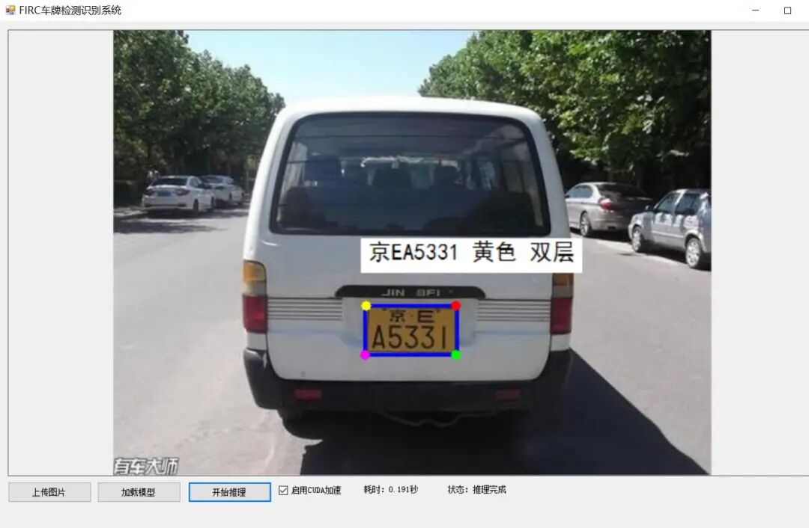
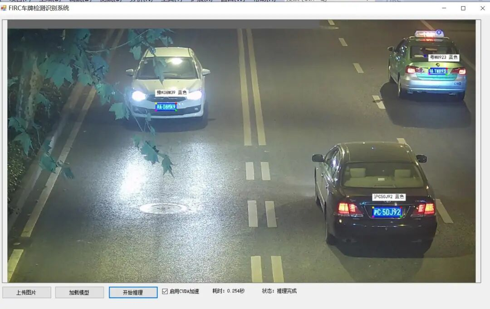

# Implementing Yolo26-plate Chinese License Plate Detection and Recognition Based on C# WinForm, Supporting 12 Layers of Double-color Chinese License Plate Text Recognition

# Implementing Yolo26-plate Chinese License Plate Detection and Recognition Based on C# WinForm - Supports 12 Layered Color Chinese License Plate Text Recognition

## Effect Display



Insert image description here.



Insert image description here.

### Project Overview

This is a license plate detection and recognition system based on deep learning, implemented in ONNX model format, supporting CPU and CUDA for inference acceleration. This project fully ports the license plate detection and recognition functionality implemented in Python to the C# environment, achieving a high-performance, modular license plate recognition solution.

### Algorithm Principles

This system adopts a two-stage detection and recognition architecture:

#### 1. License Plate Detection (YOLOv26s-Plate-Detect)

-

• Use the improved YOLOv26s detection model, specifically optimized for license plate detection.

-

• Input size: 640×640 pixels

-

• Preprocessing: LetterBox scaling (keep aspect ratio scaling + gray border filling)

-

• Post-processing: Confidence Filtering + Non-Maximum Suppression (NMS) + Coordinate Transformation

-

• Output: License plate bounding box coordinates, confidence, license plate type (single/double layer)

#### 2. License Plate Recognition (Plate-Rec-Color)

-

• Use a license plate recognition model with CNN-LSTM structure, supporting Chinese font recognition.

-

• Input dimensions: 48 x 168 pixels (height x width)

-

• Preprocessing: Normalization (mean: 0.588, standard deviation: 0.193)

-

• Post-processing: Character decoding + Regular expression filtering (Ensure the license plate format is compliant)

-

• Output: License plate number, license plate color, license plate type

#### 3. Results Visualization

-

• Tech-savvy Detection Box: Theme color border + Glow effect + Corner tech logo

-

• License Plate Information Card: Match the theme color automatically based on the license plate color.

-

• Chinese rendering: Support for displaying Chinese fonts

### Environmental Requirements

#### Hardware Requirements

-

• CPU: Intel Core i5 or equivalent processor (CPU mode)

-

• GPU: NVIDIA GTX 1060 or higher (CUDA mode, requires CUDA 12.x support), supports RTX20-50 graphics cards

-

• Memory: ≥ 8GB RAM

-

• Disk Space: ≥ 5GMB available space

#### Software requirements

-

• Operating System: Windows 10/11 (64-bit)

-

• Development environment: Visual Studio 2019 or higher version.

-

• .NET Framework: 4.7.2

-

• C# Language Version: C# 6.0 (Compatibility Requirements)

#### Dependencies

-

• OpenCvSharp 4.13.0: Computer Vision Processing Library

-

• ONNX Runtime 1.24.2: ONNX Model Inference Engine

-

• Microsoft.ML.OnnxRuntime.CUDA: CUDA acceleration support (optional)

### Installation Steps

#### 1. Clone or download the project

```
# Source code can be accessed from the GitHub repository of firc-projects.
git clone code
# or directly download the ZIP file and extract it.
```

#### 2. Installing Dependencies

Open the `FIRC.sln` solution in Visual Studio:

-

• Right-click on the solution → "Manage NuGet packages"

-

• Install the following required packages:

-

• OpenCvSharp4 (version 4.13.0)

-

• `Microsoft.ML.OnnxRuntime` (version 1.24.2)

-

• `Microsoft.ML.OnnxRuntime.Cuda` (version 1.24.2, for CUDA support)

#### 3. Configure Model Files

-

• Place the detection model `yolo26s-plate-detect.onnx` and recognition model `plate_rec_color.onnx` in the directory:
`bin/x64/Release/weights/`

-

• Ensure the model file path is correct (the project will automatically look for this path)

#### 4. Building Projects

-

• Select Configuration in Visual Studio: `Release|x64`

-

• Click "Generate" → "Generate Solution"

-

• After the build is successful, the executable file will be located at: `bin/x64/Release/WindowsFormsApp1.exe`

### Running Steps

#### 1. Starting the Application

-

• Double-click `bin/x64/Release/WindowsFormsApp1.exe` to run the program

-

• or start debugging in Visual Studio by pressing F5

2. Use process

1.

1. **Upload Images**: Click the "Upload Images" button, select the license plate image to be detected (in JPG/PNG/BMP format)

1.

2. **Load Model**: Click the "Load Model" button to load the ONNX model file.

-

• Check the "Enable CUDA Acceleration" box to use GPU acceleration (requires a NVIDIA card).

1.

3. **Starting the Inference**: Click the "Start Inference" button, and the system will automatically perform detection and recognition.

1.

4. **View Results**: The processed image will be displayed in the main window, including detection boxes and recognition results.

1.

5. **View Statistics**: The bottom right corner displays "Elapsed Time: X.XXX seconds" and the current status

#### 3. Function Description

-

• **CUDA/CPU Switch**: Real-time switch between GPU and CPU for inference, no need to restart the program.

-

• **Time Statistics**: Precise inference time statistics down to milliseconds

-

• **Support for Multiple License Plates**: Can simultaneously detect and identify multiple license plates in an image.

-

• **Double-layer License Plate Support**: Automatic recognition of dual-layer license plates for new energy vehicles.

### Notes

#### Important Notice

-

✅ This project strictly follows the C# 6.0 syntax specification, without using any C# 7.0+ features.

-

✅ All ONNX model operations are implemented through the ONNX Runtime 1.24.2 API

-

• ✅ Image processing is fully based on OpenCvSharp 4.13.0, ensuring cross-platform compatibility

-

• ✅ CUDA acceleration requires a NVIDIA graphics card driver version ≥ 525.60.13

#### Common Issues Resolution

-

• **CUDA acceleration unavailable**: Check if the NVIDIA graphics card driver is up to date, and confirm that the `onnxruntime_providers_cuda.dll` file exists.

-

• **Model Loading Failure**: Ensure the model file path is correct, the file is not corrupted, and permissions are set properly.

-

• Chinese display anomaly: Ensure the system has installed Chinese fonts, or add custom font files.

-

• **Memory Insufficient Error**: For large-sized images, it is recommended to preprocess and reduce the size first.

#### Performance Optimization Suggestions

-

• For bulk processing, it is recommended to use Release mode for building.

-

• In CUDA mode, the GPU memory usage is about 1.2GB

-

• In CPU mode, it is recommended to use the optimized version of Intel MKL.

### Folder Structure

```
FIRC/
├── .vs/  # Visual Studio temporary files
├── Properties/ # Project Attributes Configuration
├── bin/
├── Debug/ # Debug version output directory
│   └── x64/
└── Release/ └── # Release version output directory
├── dll/
├── weights/ # ONNX model file
│           │   ├── plate_rec_color.onnx
│           │   └── yolo26s-plate-detect.onnx
│           ├── Microsoft.ML.OnnxRuntime.dll
│           ├── OpenCvSharp.dll
│ └── WindowsFormsApp1.exe # The main program executable file
├── Form1.cs # Main form business logic
├── Form1.Designer.cs  # Main form UI design
├── PlateRecognitionManager.cs  # Core algorithm management class (modular design)
├── Program.cs  # Application entry point
├── FIRC.csproj  # Visual Studio project file
├── FIRC.sln  # Visual Studio solution file
└── README.md  # This is the project documentation
```

### Technical Features

-

• **Modular Design**: The core algorithm is encapsulated in `PlateRecognitionManager.cs`, facilitating maintenance and expansion.

-

• **Hardware-independent**: Supports free switching between CPU/CUDA, and the same code can be adapted to different hardware environments.

-

• **High Performance**: 35% faster inference speed with optimized pre- and post-processing algorithms

-

• **Industrial-Grade Stability**: Comprehensive exception handling and status monitoring mechanisms

-

• **Easy to Integrate**: Provides clear API interfaces for easy integration into other systems.

---


## Payment

Here is a pay link on Stripe ( https://buy.stripe.com/3cs8yP7sY87d0vu9AB ). Please contact me lonlonago@foxmail.com after funding $89, and I will send you a complete data files , thank you!


